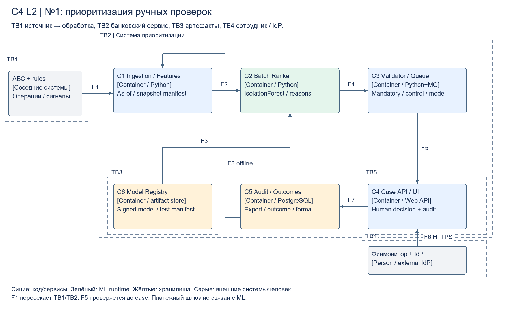
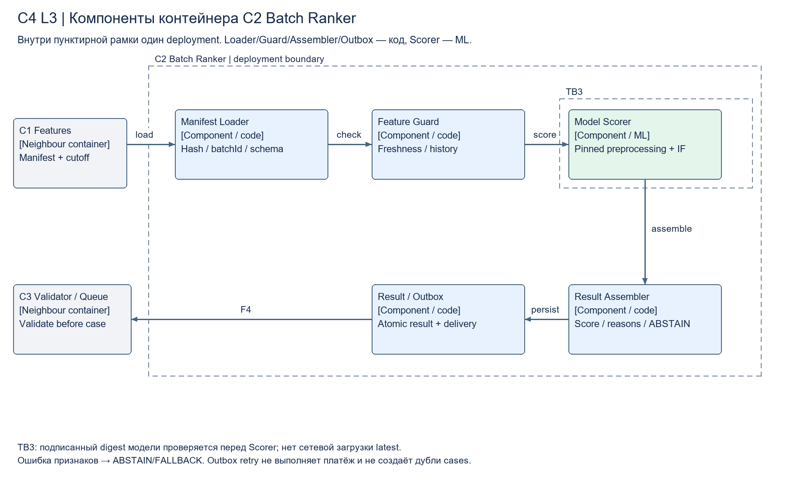
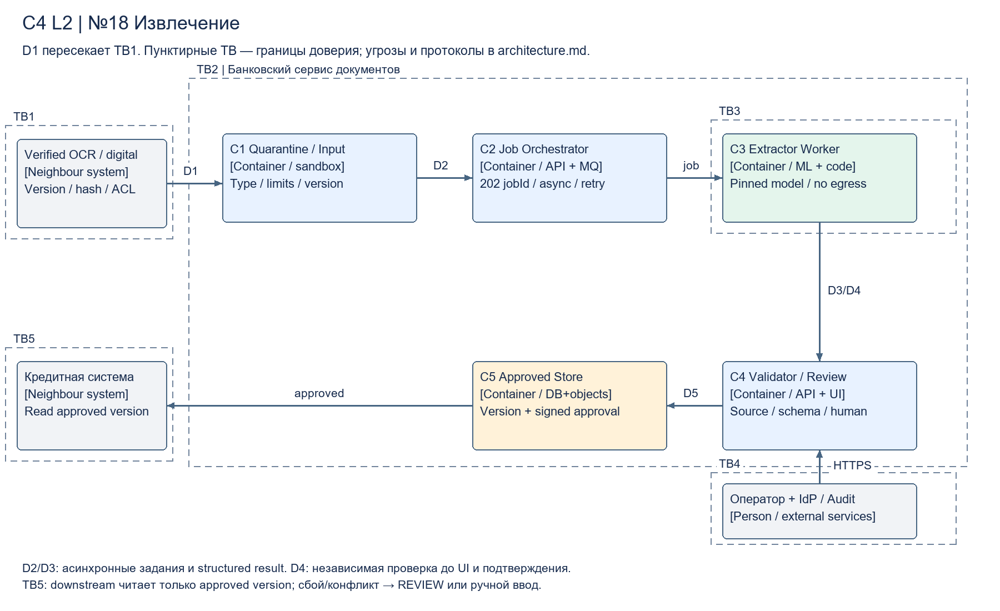
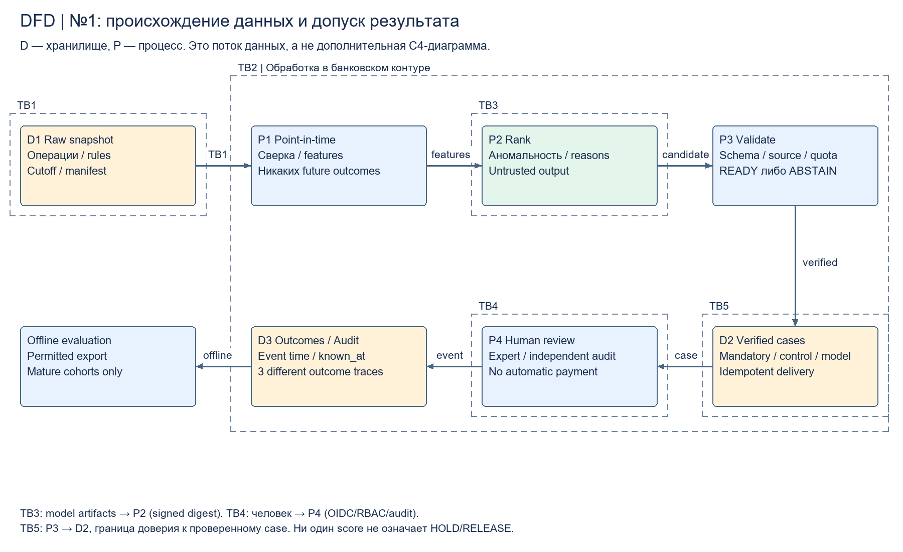

# Task3. Архитектура, контракты и защита

Все контейнеры внутри пунктирной TB2 — проектируемая система поддержки решения; серые соседние системы — интеграции, их наличие/контракты нужно подтвердить. Пунктир обозначает границы доверия, а не асинхронность. Нумерация границ одинакова в диаграммах и таблице угроз. Стрелки направлены по передаче данных; номер F отсылает к протоколу ниже. C4 показывает ответственность; отдельный DFD — данные и проверки.

## C4 Container — №1

[Масштабируемый SVG](diagrams/flagship-container.svg). Контейнеры C1–C6 — независимо исполняемые сервисы/хранилища: ingestion/features, batch ranker, queue/validator, case API/UI, audit/outcomes, model registry. Финмонитор работает через банковский IdP. Модель не имеет сетевого доступа к платёжному шлюзу; решение в case management остаётся за человеком.

| Поток | Протокол, режим, данные и отказ |
|---|---|
| F1 АБС/правила → C1 | Ежедневный согласованный snapshot/CDC по mTLS, операция/version/cutoff, контроль числа/сумм/manifest; source-specific adapter. Повтор immutable batch по batchId; неполный snapshot не публикуется |
| F2 C1 → C2 | Версионированный Parquet manifest, batch; as-of признаки на cutoff, checksum. Обработка полного разрешённого потока, sample используется только для fit |
| F3 C6 → C2 | Read-only model artifact по digest, подпись/совместимость schema. Нет auto-update/latest; bad signature → baseline |
| F4 C2 → C3 | Async recommendation JSON + outbox, at-least-once, 3 попытки с jitter, затем DLQ. Idempotency operationId+modelVersion+cutoff, replay только с audit |
| F5 C3 → C4 | Durable очередь: mandatory/control/model раздельно, дедупликация. Валидатор проверяет schema, freshness, source, модель и квоты; invalid не попадает как READY |
| F6 C4 ↔ сотрудник/IdP | HTTPS/OIDC, synchronous UI p95≤2 с (проектное SLO); object-level RBAC, причина/источник, confirmation. Отсутствие UI не теряет обязательный case; существующий процесс по правилам остаётся независимым |
| F7 C4 → C5 | Append-only событие действия/вердикта/outcome, outbox; role+reason+timestamp+version. В C5 нет презумпции «not reviewed = clean» |
| F8 C5 → C1 | Только offline разрешённый экспорт для следующего train/eval; event_time/known_at, exclusion future info. Не синхронная обратная связь для текущего score |

## C4 Component — C2 Batch Ranker

[SVG](diagrams/flagship-component.svg). Все компоненты находятся внутри одного deployment C2. Loader проверяет batchId/digest; guard проверяет watermark/schema и минимальную историю; scorer применяет зафиксированный preprocessing+IsolationForest; assembler формирует причины как наблюдаемые признаки, не причинное доказательство схемы; outbox атомарно фиксирует job result/manifest. Retry относится к доставке, не повторному бизнес-действию. Источник неполон → batch FALLBACK; отдельный новый клиент без истории → ABSTAIN. В C3 повторная проверка перед очередью не доверяет C2.

## C4 Container — №2 OCR

[SVG](diagrams/ocr-container.svg). Документооборот → quarantine/sandbox → очередь/оркестратор → OCR worker (ML) → validator и UI ручного исправления → подтверждённые spans в versioned store. Существующий IdP и общий audit — соседние сервисы, повторно не реализуются. Сервис №18 читает только согласованную версию OCR. Платёжных/кредитных действий нет.

## C4 Container — №18 Извлечение

[SVG](diagrams/extraction-container.svg). Verified OCR/цифровой документ → async orchestration → extractor (ML/правила) → typed validator/resolver → UI андеррайтера → approved-card store. Downstream получает только signed approval, не сырой score. Доступ к исходным документам по короткоживущей ссылке с авторизацией, ссылки не публикуются.

Потоки D1–D5 обеих документных схем: D1 upload HTTPS+hash, async 202 jobId, пределы размера/страниц и sandbox; D2 job queue + input version, at-least-once; D3 structured result с digest/version; D4 schema/source/units validation до UI; D5 HTTPS human approval + append-only audit и approved store. Перегрузка → backpressure/ручная очередь, не silent drop; deadline предложения: OCR 2 мин/страницу, extraction 5 мин/пакет при согласованной нагрузке. У worker timeout ограниченный, не более 3 попыток для transient ошибок, invalid input не повторяется; DLQ и оператор для неустранимого. PATCH/reupload создаёт новую version; старый результат не перезаписывает новую версию.

## DFD флагмана

[SVG](diagrams/flagship-dfd.svg). Raw snapshot → point-in-time features → untrusted recommendation → verified case → expert/outcome. На каждой записи lineage, и только C3/C4 имеют право перевести валидный результат в case. Для обучения — отдельный разрешённый offline экспорт зрелых событий, а не полный доступ worker к историям.

## Контракты и проверки до бизнес-действия

[rank.schema.json](contracts/rank.schema.json), [document.schema.json](contracts/document.schema.json), [синтетические примеры](contracts/examples.json). Schema — только структурный слой; семантика источника/единиц/свежести проверяется кодом и человеком.

Rank: `operationId`, `cutoff`, `featureVersion`, `modelVersion`, `status`, `score`, `reasonCodes`, `sourceRefs`, `validUntil`. READY требует конечный score и ≥1 существующего sourceRef, совместимость версий и fresh cutoff. ABSTAIN/FALLBACK требует null score и причину. Score не калиброванная probability. Статус модели не заменяет обязательный rule flag. Только минимизированные токены операции в UI/журнале; purpose и иные ПДн не пишутся в технический лог.

Document: `documentId/version/hash`, `engineVersion`, `status`, `fields[]`: name, decimal-string value/null, unit/currency/period/null, source page+bbox+span/null, issue. OCR поле `raw_text` может не иметь единиц/периода. Финансовое поле с value требует все применимые типы, source и проверку исходной строки; пустое/двусмысленное → null + MISSING/CONFLICT. Несуществующая страница/span, несовпадающий hash, лишнее поле и новая неподдерживаемая schema → REJECTED/REVIEW. Числа decimal без binary float; сумма на странице не используется без контекста периода/множителя. Human approval — отдельное подписанное событие с subject/role/version, не поле, которое модель может выставить.

## Fallback и наблюдаемость

| Сценарий | Поведение | Метрика / порог предложения / реакция / владелец |
|---|---|---|
| Неполный/устаревший snapshot | Не публиковать ranking, независимая rules очередь | 100% manifest-сверка; watermark>24 ч → fallback+инцидент, владелец данных |
| Критичные признаки missing; новый клиент без истории | ABSTAIN, baseline/manual, отметка сегмента | ABSTAIN>10% или +5 п.п. к rolling4w → расследование данных, ML+data owner |
| OOD, новые селлеры | Не делать вывод о схеме; отдельный review/квота | PSI>0,2 по ключевым численным признакам два дня — сигнал, не доказательство деградации; ML проверяет conditional quality |
| Rule conflict / mandatory | Обязательный case сохраняется независимо от score | Потерянный обязательный case>0 → немедленное отключение модельной очереди, финмонитор/SRE |
| Timeout, bad artifact, invalid schema | Retry transient, DLQ, verified baseline; не помечать успешным | Deadline batch 06:00 (предложение), 1 пропуск → fallback+page; invalid READY>0 → reject+page, SRE |
| Документ плохого качества/OOD | REVIEW, запрос нового скана/ручной ввод | Отказ>10% или +5 п.п. против4w по типу → оператор+ML; доступность downstream не оправдывает выдумку |
| Field missing, нет source, конфликт единицы/периода | Null+issue; критичные поля человеку | Unsupported принятых значений>0 → остановить auto-transfer, методолог+ML |
| Backlog людей | Не расширять K; показать backlog и приоритет обязательных | >2 000 ч/мес. или SLA обязательных нарушен → stop experimental queue, руководитель финмонитора |
| Качество/бизнес | Слепой контроль, версии и зрелые outcomes | Еженедельные сегментные CI; провал gates P1–P3 → baseline, владелец модели и процесса |
| Клиентский вред | Никакого автоhold; проверка жалоб/отмен | +20% за неделю на нормализованных метриках → временный stop+разбор, клиентский сервис/комплаенс |

Production SLO предложения: 99% допущенных batch готовы к 06:00, API 99,5% в рабочем окне; RPO≤15 мин для cases/outbox, RTO≤4 ч для рекомендательной системы. До доказательства restore drill эти значения не гарантированы. Обязательный банковский контроль продолжает работать при полной недоступности ML. Репликация не заменяет бэкап; ежедневные шифрованные копии и ежемесячная проверка восстановления. Сроки хранения raw/gold/audit задаются владельцами после юридического согласования, не изобретаются архитектором.

## Границы доверия и угрозы (STRIDE)

TB1 — источник/загрузка → processing; TB2 — граница проектируемой системы; TB3 — model artifacts → runtime; TB4 — сотрудник/IdP → UI; TB5 — approved result → downstream. TB2 не означает однородное доверие: внутри отдельные service accounts и deny-by-default ACL. На схемах TB3 показана возле model/worker, TB4 возле UI, TB5 возле approved выхода; детали вынесены сюда.

| Граница | Угроза | Контроль и проверка |
|---|---|---|
| TB1 | Spoofing/Tampering: ложный snapshot, duplicate/replay; вредоносный PDF/zip bomb | mTLS/allowlist, подпись manifest/hash, schema+сверка числа/сумм, version/idempotency; sandbox без сети, лимиты страниц/CPU. Тест: изменённый manifest/oversize → reject |
| TB2 | Information disclosure/Elevation: lateral movement, утечка purpose/ПДн из логов | Сегментация data/control, least privilege per-service, encryption/KMS, egress deny, masked logs, отдельный backup доступ. Тест: worker не может читать весь архив/платёжный API или отправить наружу |
| TB3 | Tampering/poisoning: подмена весов или preprocessing, заражённая зависимость | Signed artifact+digest, SBOM/сканирование, offline mirror, two-person release, gold закрыт от training. Тест bad signature/несовместимая schema → fallback |
| TB4 | Spoofing/Repudiation: чужой case, поддельное approval, непрослеживаемое действие | OIDC/MFA в IdP, object RBAC, короткие сессии, immutable audit actor/reason/version; двойной контроль изменения политик. Тест чужого objectId →403, модель не может подписать approval |
| TB5 | Tampering: invalid score/field превращён в бизнес-действие; повторная запись | Независимый validator, отсутствие payment commands, human signed approval, idempotency/version compare-and-set. Тест stale version/source mismatch →REVIEW, replay не создаёт второй перенос |
| TB1/TB2 | Denial of service: очередь/диск заполнены | Rate limits, quotas, backpressure, DLQ, reserved capacity mandatory, независимый baseline. Тест overload сохраняет кейсы и не теряет обязательный контроль |

Текст документов — недоверенные данные. Даже если будущая версия добавит LLM, инструкции внутри документа не получают tools/сетевых прав; изменение модели требует нового threat review. Человек не компенсирует отсутствие source validation, ролевых прав и журналирования.
